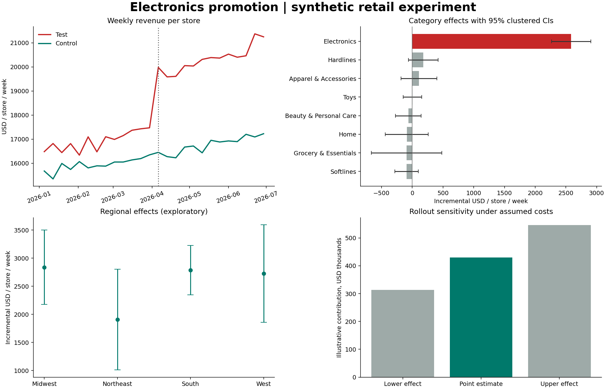

# Electronics promotion: decision brief

Synthetic portfolio case study — not Target company data or an actual business result.

**Decision:** consider a limited follow-up pilot, subject to verified margins, stock
availability and promotion costs. Revenue evidence alone does not justify chain-wide rollout.

- Across 28 test and 32 control stores, the additive
  difference-in-differences estimate is **$2,585.55 additional
  revenue per test store per week** (95% store-clustered CI:
  $2,265.95–$2,905.16).
- Over 13 weeks, that is **$941,141.76 estimated
  incremental revenue** in the test stores (CI $824,804.67–
  $1,057,478.85). This assumes the control group's
  dollar change represents the test group's counterfactual dollar change.
- The average store growth gap is **14.89 percentage points**.
  This is a separate estimator, not the percentage version of the dollar estimate.
- Under explicitly assumed 30% margin, 2%
  additional promotion cost on treated sales and $500 fixed cost per store,
  a 100-store / 13-week sensitivity scenario gives
  **$429,649.85 incremental contribution**. This is not a forecast or observed profit.

**Checks:** complete store/category/week panel, SQL-to-Python reconciliation,
store-clustered regression, whole-store bootstrap, pre-period slope diagnostic,
per-category placebo and regional comparisons with Holm correction.

**Limits:** only 13 weeks before and after; original allocation algorithm unavailable;
synthetic effects can be designed into the data. Nonsignificant placebo/pretrend tests
do not prove no spillovers or parallel counterfactual trends. Category aggregates
cannot identify individual SKU substitution, order conversion or true basket value.
Margins, inventory, redemption costs and sustained demand are not observed.

